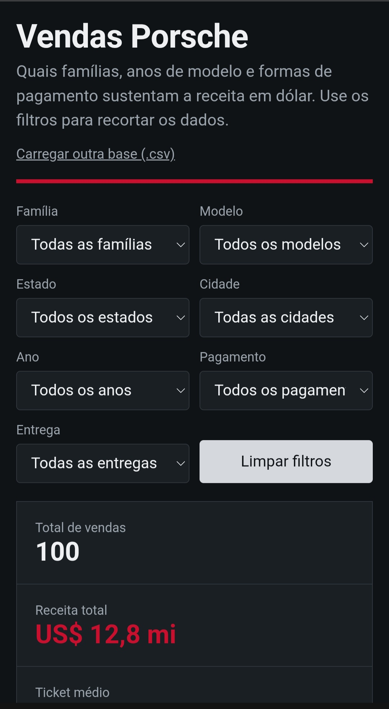
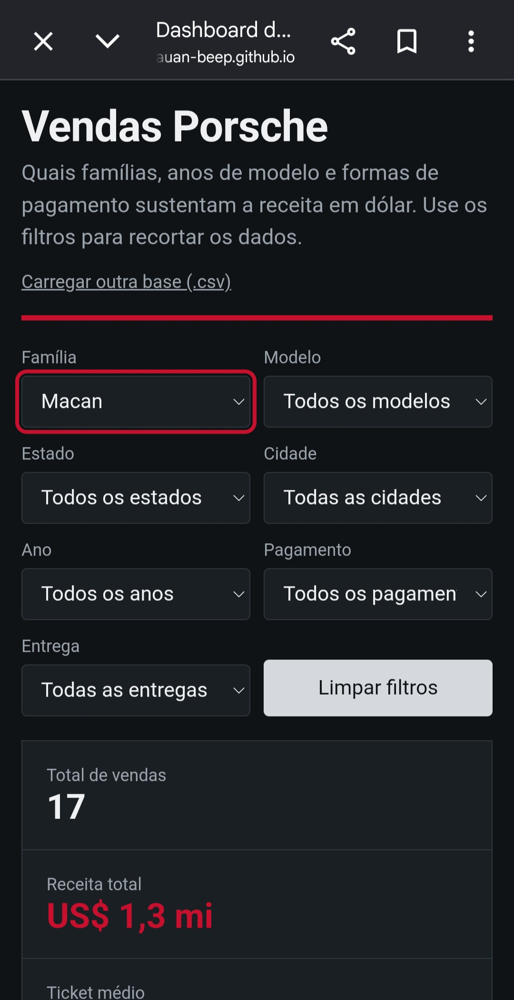
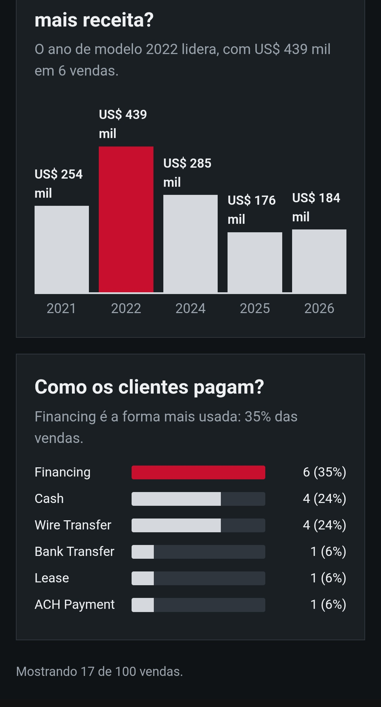

# Excel com IA: dashboard de vendas Porsche

Dashboard interativa criada a partir da planilha sanitizada de 100 vendas da Porsche (desafio "Criando uma Dashboard da Porsche com Agentes de IA", DIO), com a liberdade visual que os gráficos do Excel não dão.

**Dashboard publicada:** https://kauan-beep.github.io/excel-ia-dashboard-porsche/

### Dashboard completa





### Exemplo de filtro aplicado: família Macan

Ao escolher a família Macan, o total cai de 100 para 17 vendas, a receita para US$ 1,3 mi e o ticket médio para US$ 78.726. Entre os Macan, o ano de modelo 2022 lidera e Financing passa a ser a forma de pagamento mais usada.








## Perguntas de negócio

1. **Quais famílias de modelos geram mais receita?** (911, Cayenne, Macan, Taycan, Panamera e 718). Agrupei os 40 modelos em 6 famílias, porque 40 barras não se leem em uma tela.
2. **Qual ano do modelo concentra mais receita?** Mostra quais anos de fabricação mais vendem.
3. **Como os clientes pagam?** Mostra o peso de cada forma de pagamento (transferência, cartão, financiamento, à vista, leasing e outras).

Cada gráfico tem uma frase de leitura que se atualiza com os filtros.

## Indicadores e filtros

- Indicadores de topo: total de vendas, receita total (US$) e ticket médio.
- Filtros: família, modelo, estado, cidade, ano do modelo, forma de pagamento e status de entrega.
- Botão para limpar filtros e opção de carregar outra base em CSV.

## Tratamento da base antes da IA

- Usei só as colunas sanitizadas: `PorscheModelSanitized`, `ModelYearSanitized`, `SalesPriceSanitized`, `PayMethodSanitized`, `CitySanitized`, `StateSanitized` e `DeliveryStatusSanitized`.
- Preço e ano já estavam como número; conferi que não havia células vazias nessas colunas.
- A coluna `SaleDateSanitized` tem 24 registros `INVALID` em 100. Por isso a pergunta por ano usa o **ano do modelo**, e não a data da venda.
- Criei a "família" do modelo a partir da primeira palavra do nome (por exemplo, "Macan GTS" vira "Macan").
- Embuti os dados no HTML.
- Não usei nome de cliente nem de vendedor, para não expor dado pessoal em um repositório público.

## Prompt

```
Tenho uma planilha com 100 vendas da Porsche (modelo, cidade, estado, ano do modelo, preço em dólar,
forma de pagamento e status de entrega).
Crie uma dashboard em HTML de arquivo único que responda 3 perguntas:
1) quais famílias de modelos geram mais receita, 2) qual ano do modelo concentra mais receita,
3) como os clientes pagam. Inclua filtros por família, modelo, estado, cidade, ano, pagamento e entrega,
e indicadores de topo com total de vendas, receita e ticket médio. Dados embutidos no HTML, sem bibliotecas externas.
```

O que mudou até a versão final:

- Troquei os gráficos por barras em HTML/CSS, para funcionar sem internet e sem biblioteca.
- Adicionei uma frase de leitura abaixo de cada pergunta.
- Troquei o eixo "ano da venda" por "ano do modelo", por causa dos registros `INVALID` nas datas.
- Agrupei os modelos em famílias.
- Defini a paleta: cinza-grafite, branco gelo e vermelho Porsche como destaque.

## Ferramentas usadas

- Excel para ler e conferir a base sanitizada.
- IA (Claude) para gerar e refinar o HTML.

## Arquivos

- `index.html`: a dashboard completa (HTML, CSS e JavaScript), com a base embutida.
- Imagens `Screenshot_*.jpg`: capturas de tela da dashboard, sem filtro e com o filtro Macan.
